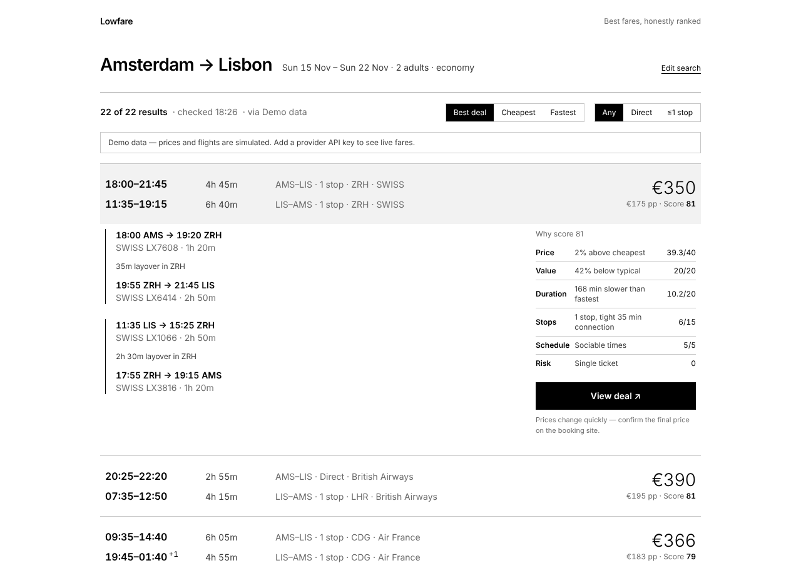

# Lowfare

Real-time flight search that ranks every fare by an explainable **Deal Score**. The score weighs price,
value against the route's typical price, duration, stops/connection quality, schedule and ticketing risk.
Minimal black/white/grey interface.



- Product & engineering brief: [`CLAUDE.md`](CLAUDE.md) (Claude Code reads this automatically)
- Roadmap & status: [`docs/NEXT_STEPS.md`](docs/NEXT_STEPS.md)
- Decisions: [`docs/decisions/`](docs/decisions)

## Quick start

```bash
corepack enable            # pnpm 10, Node 22 (see .nvmrc)
pnpm install
pnpm dev                   # http://localhost:3000 — demo data, no keys needed
```

To see live fares, copy `apps/web/.env.example` to `apps/web/.env.local` and set `SERPAPI_API_KEY`.

## Layout

```
apps/web         Next.js 16 app: UI, /api/search (Server-Sent Events), CSP proxy
packages/core    Domain logic: schemas, money, Deal Score, dedupe, airports, providers, aggregator
```

## Checks (all run in CI)

| Command             | What                                                   |
| ------------------- | ------------------------------------------------------ |
| `pnpm lint`         | ESLint                                                 |
| `pnpm typecheck`    | TypeScript strict                                      |
| `pnpm test`         | Vitest unit + property-based + provider contract tests |
| `pnpm build`        | Production build                                       |
| `pnpm e2e`          | Playwright desktop + mobile, axe accessibility, CSP    |
| `pnpm format:check` | Prettier                                               |

CI also runs gitleaks (secret scan), `pnpm audit`, dependency review and CodeQL. All actions are pinned by SHA.

To run e2e locally with an existing Chromium, set `PW_CHROMIUM_PATH=/path/to/chrome`. Otherwise
run `pnpm --filter @lowfare/web exec playwright install chromium`.
